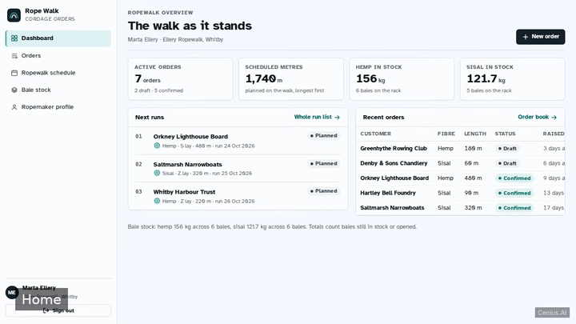
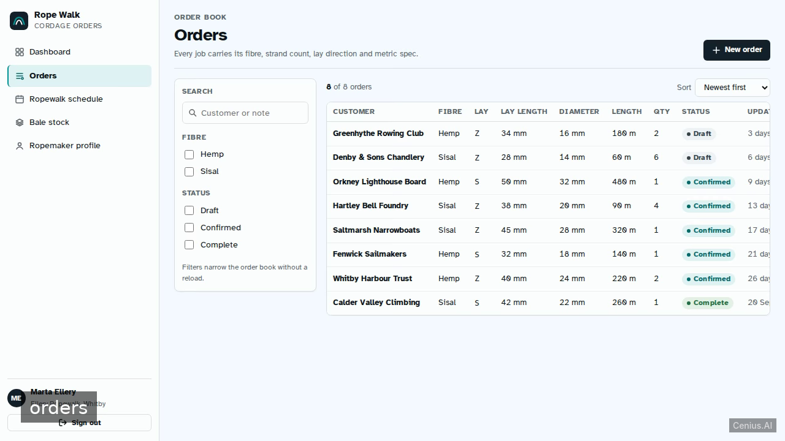
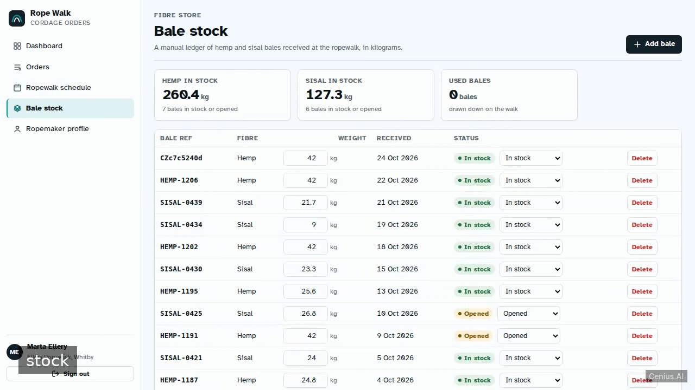
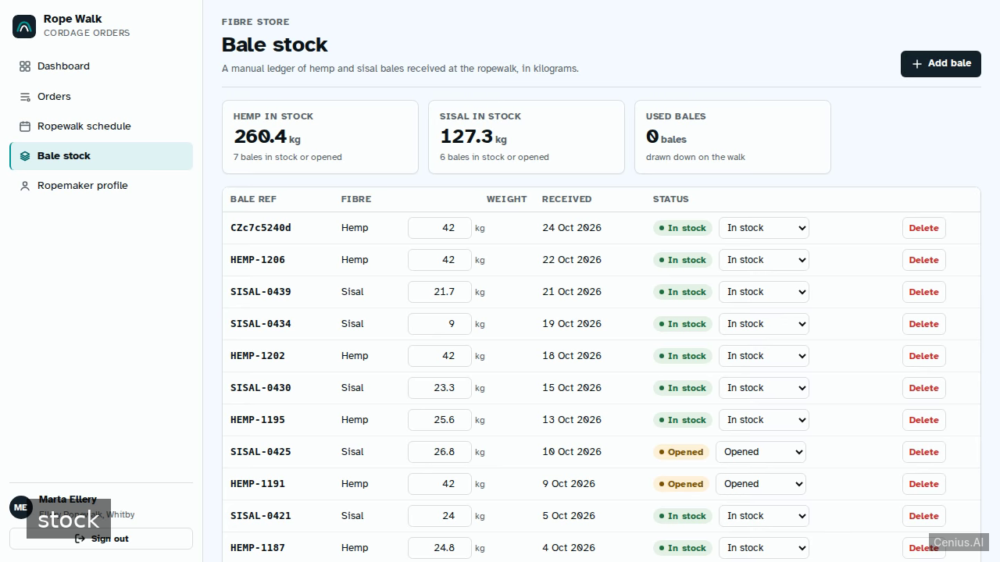

# Rope Walk Cordage Orders — production-ready Vite monitoring dashboard starter

This repository contains the complete source for **Rope Walk Cordage Orders**, an open-source monitoring dashboard built with Vite. A two-service web app for a small ropewalk: a FastAPI backend (backend/) with bcrypt password hashing, PyJWT bearer sessions, SQLAlchemy models on SQLite and idempotent seed data, plus a Vite React frontend (frontend/…. Everything Rope Walk Cordage Orders needs to run is here — code, seed data, install scripts. Apache-2.0-licensed — use Rope Walk Cordage Orders commercially, self-host it, or [remix Rope Walk Cordage Orders on cenius.ai](https://cenius.ai/marketplace/p/rope-walk-cordage-orders?ref=gh&utm_campaign=rope-walk-cordage-orders-vite) to make it yours.


[](LICENSE)  [](https://cenius.ai)

[](https://cenius.ai/marketplace/p/rope-walk-cordage-orders?ref=gh&utm_campaign=rope-walk-cordage-orders-vite)

> **▶ [Open & edit in cenius.ai](https://cenius.ai/marketplace/p/rope-walk-cordage-orders?ref=gh&utm_campaign=rope-walk-cordage-orders-vite)** — one click to an editable workspace: describe changes in plain English, get an instant preview, one-click deploy and host. Modifications made on the platform come with full rebrand & relicense rights.

_Local clone? See [Quick start](#quick-start) below. cenius.ai is the zero-setup path._

## Demo



📽 **[Watch the walkthrough](https://cenius.ai/marketplace/p/rope-walk-cordage-orders?ref=gh&utm_campaign=rope-walk-cordage-orders-vite)** — plays on cenius.ai · [MP4 file](.github/media/demo.mp4)

## Screenshots

  

## Quick start

```bash
./install.sh   # installs dependencies + seeds demo data
```

See [`INSTALL.md`](INSTALL.md) for full setup and usage instructions.

## Architecture

Folder layout: `backend/`, `frontend/`. Starting up is just `./install.sh`: it installs what is needed and pre-fills the database so you have data to work with straight away. Built in Vite (95 files). See [`INSTALL.md`](INSTALL.md) for complete setup instructions.

## Features

- Email + password login with seeded demo account
- Orders with rope lay and fibre spec
- Ropewalk production schedule by length
- Hemp and sisal bale stock
- Ropemaker profile page
- Dashboard overview of the ropewalk

## Usage guide

Sign in at `/login` with **cenius@cenius.ai / cenius** (printed on the card; the "Use demo
credentials" button fills both fields). The token is kept in `localStorage`, so a reload of
any gated page keeps you signed in.

### Dashboard (`/`)

A factual summary of the walk: active orders (with the draft/confirmed split), total
scheduled metres, hemp and sisal kilograms still in stock, the next three runs with fibre,
lay direction and length, and the five most recent orders. Tiles and rows link through to
their screens. If the API is unreachable you get an error card with **Retry** rather than
blank panels.

### Order book (`/orders`)

A dense table of every order: customer, fibre, lay direction, lay length (mm), diameter
(mm), finished length (m), quantity, status and when it last changed.

- The left rail filters by search text, fibre (hemp/sisal) and status (draft/confirmed/
  complete). Filters combine; **Clear all filters** resets them. "0 of 12 orders" with the
  filter still applied is shown as its own state so you can tell "nothing matches" from
  "the book is empty".
- **Sort** reorders by newest, longest, customer or status.
- **New order** opens the create form.

### Creating an order (`/orders/new`)

The form captures the whole rope lay and fibre spec: customer, fibre, strand count, lay
direction (Z right-hand / S left-hand), lay length in millimetres, rope diameter in
millimetres, finished length in metres, quantity, status and notes. Numeric defaults are
plausible, so the form submits as soon as a customer is named.

_Full guide: [`USAGE.md`](USAGE.md)_

## FAQ

### Can I deploy Rope Walk Cordage Orders on my own infrastructure?

It runs entirely on your own machine. Clone, run `./install.sh`, and follow [`INSTALL.md`](INSTALL.md) — the whole stack is in this repo, no external dependencies required.

### How can I customize Rope Walk Cordage Orders without editing code?

Open it on [cenius.ai](https://cenius.ai/marketplace/p/rope-walk-cordage-orders?ref=gh&utm_campaign=rope-walk-cordage-orders-vite) and describe the changes you want in plain English — the platform modifies the app and gives you a new, downloadable build.

### Can I remove the Rope Walk Cordage Orders name and use my own?

Yes — and the easiest way is [remixing it on cenius.ai](https://cenius.ai/marketplace/p/rope-walk-cordage-orders?ref=gh&utm_campaign=rope-walk-cordage-orders-vite): modifications made on the platform come with full rebrand and relicense rights over your derivative.

### What powers Rope Walk Cordage Orders under the hood?

Vite. The full source in this repository is exactly what the app runs. Highlights include hemp and sisal bale stock.

### Can I use Rope Walk Cordage Orders in a commercial project?

The code is under the Apache-2.0 license, which allows commercial use without restriction. You can build, sell, and deploy it freely. Full text: [LICENSE](LICENSE).

## License & rebranding

Released under the [Apache License 2.0](LICENSE) (© 2026 Cenius AI) — free for personal and commercial use. The Cenius name/logo are trademarks (see NOTICE).

**Need a customized version?** [Remix this app on cenius.ai](https://cenius.ai/marketplace/p/rope-walk-cordage-orders?ref=gh&utm_campaign=rope-walk-cordage-orders-vite) — modifications made on the platform come with **full rebrand & relicense rights** over your derivative.

## Built with cenius.ai

This entire application — code, design, seeded demo data — was generated on **[cenius.ai](https://cenius.ai)** from a plain-English description.

- 🚀 [Build your own app on cenius.ai](https://cenius.ai)
- 🎛️ [Remix Rope Walk Cordage Orders on the marketplace](https://cenius.ai/marketplace/p/rope-walk-cordage-orders?ref=gh&utm_campaign=rope-walk-cordage-orders-vite) — open it in a workspace, prompt for changes, and ship your own version.

More open-source apps: [the Cenius-ai catalog](https://github.com/Cenius-ai) · [showcase index](https://github.com/Cenius-ai/showcase)
